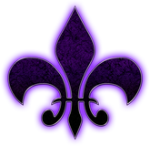
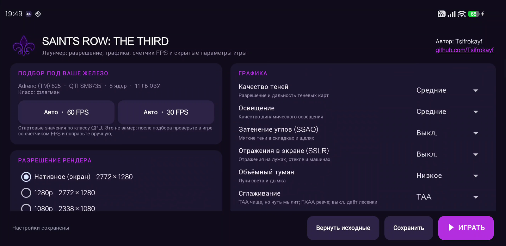
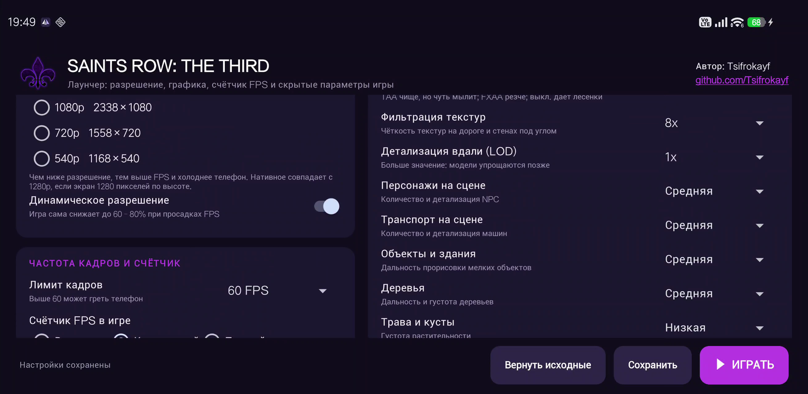
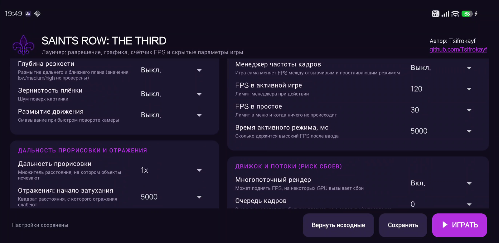
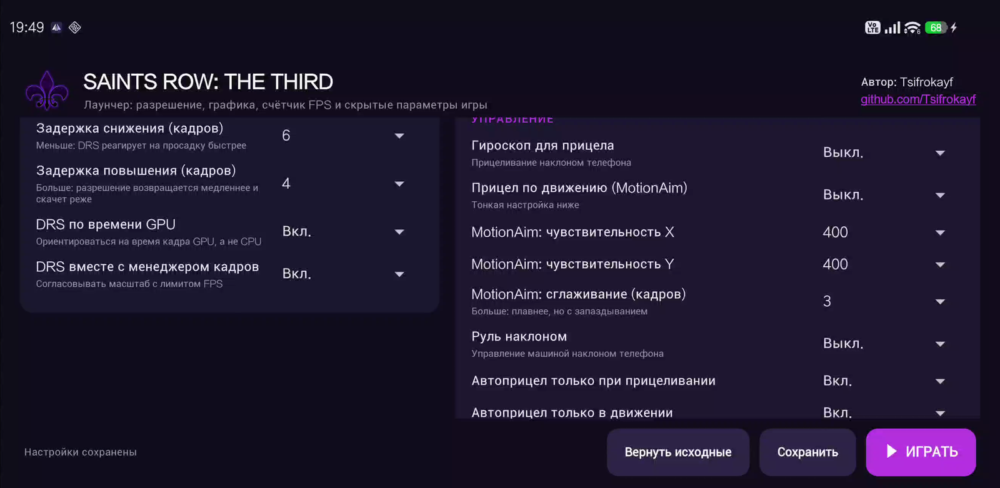
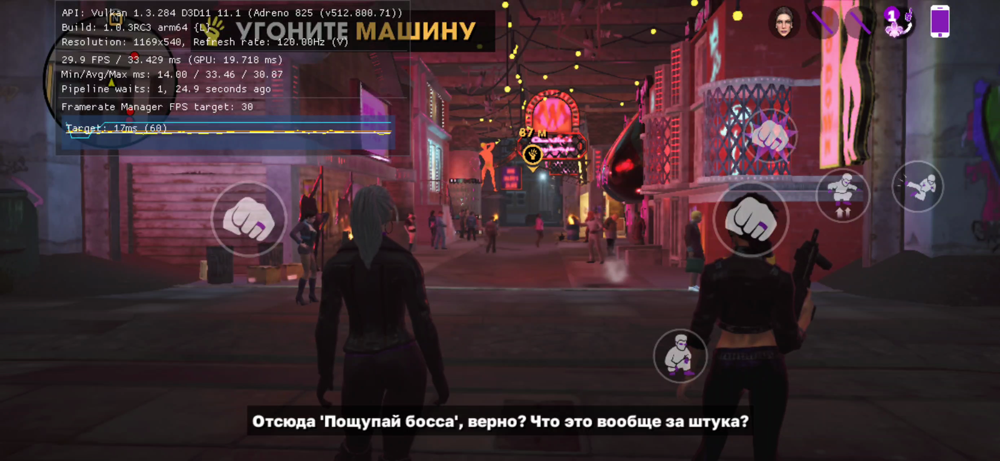

<p align="center">
  
</p>

<h1 align="center">SR3 Launcher</h1>

<p align="center">
  Лаунчер для <b>Saints Row: The Third</b> (Android-порт Feral Interactive):<br>
  разрешение, графика, частота кадров, счётчик FPS и скрытые параметры движка, которых нет в меню игры.
</p>

<p align="center">
  
</p>

> **English:** SR3 Launcher is a small Android app that edits the preferences file of the Feral Interactive port of
> *Saints Row: The Third* (`com.feralinteractive.saintsrow3_android`) through [Shizuku](https://shizuku.rikka.app/).
> It lets you pick the render resolution, per-option graphics quality, FPS limit, the built-in FPS/performance overlay,
> and dozens of hidden engine options. It does not modify the game APK and needs no root.

## Зачем это нужно

В Android-порте почти нет настроек: картинка получается мутной (игра сама снижает разрешение), а выбрать
тени, отражения, сглаживание или лимит кадров нельзя. Все эти значения лежат в одном файле настроек игры.
Лаунчер читает и аккуратно правит именно этот файл, а потом запускает игру.

## Возможности

- **Подбор под ваше железо.** Кнопки «Авто · 60 FPS» и «Авто · 30 FPS» определяют класс GPU
  (Adreno, Mali, Immortalis, Xclipse; запасной вариант по ОЗУ и числу ядер) и выставляют стартовый набор настроек.
- **Разрешение рендера:** нативное, 1280p, 1080p, 720p, 540p и динамическое разрешение (DRS).
- **Частота кадров:** лимит 30 / 40 / 60 / 90 / 120 FPS (только то, что поддерживает экран).
- **Счётчик FPS в игре:** встроенная статистика движка: FPS, время кадра, время GPU, масштаб DRS. Выключен / компактный / полный.
- **Графика по отдельности:** тени, освещение, SSAO, SSLR, объёмный туман, сглаживание (выкл. / FXAA / TAA),
  анизотропия, дальность LOD, персонажи, транспорт, объекты, деревья, трава, эффекты, резкость CAS, кубические отражения,
  текстуры персонажей высокого разрешения.
- **Апскейлер игры:** метод (0–4), резкость, CAS через пиксельный шейдер.
- **Скрытые параметры**, которых нет в меню игры:
  глубина резкости, зернистость плёнки, размытие движения; множитель дальности прорисовки и затухание отражений;
  тонкая настройка DRS; менеджер кадров; многопоточный рендер и очередь кадров, параметры Vulkan;
  гироскоп, MotionAim, руль наклоном, автоприцел и другие.
- **Резервная копия.** При первом сохранении создаётся копия исходного файла настроек, кнопка «Вернуть исходные» её восстанавливает.

<p align="center">
  
  
</p>
<p align="center">
  
  
</p>

## Требования

- Android 11 или новее (`minSdk 30`).
- Установленная игра **Saints Row: The Third** (`com.feralinteractive.saintsrow3_android`, проверено на v1.0.3RC3).
- [Shizuku](https://shizuku.rikka.app/), запущенный и с выданным разрешением для лаунчера.
  Он нужен, потому что Android 11+ не даёт обычным приложениям писать в `Android/data` другого приложения.
- Игра должна быть запущена хотя бы один раз до главного меню: при этом создаётся файл настроек.

## Первая настройка (пошагово)

### 1. Установите и запустите Shizuku

1. Установите Shizuku из Google Play или со [страницы релизов](https://github.com/RikkaApps/Shizuku/releases).
2. Включите режим разработчика: **Настройки → О телефоне → Номер сборки**, нажмите 7 раз.
3. Откройте **Настройки → Для разработчиков → Беспроводная отладка** и включите её (нужна сеть Wi‑Fi).
4. В приложении Shizuku выберите **«Запуск через беспроводную отладку»**, затем **«Сопряжение»**:
   откройте в настройках «Сопряжение устройства с помощью кода», введите код в уведомление Shizuku.
5. Нажмите **«Запустить»**. Вверху должно появиться «Shizuku работает».

> Без root Shizuku нужно запускать заново после каждой перезагрузки телефона.

### 2. Запустите игру один раз

Установите игру, запустите её, дождитесь главного меню и закройте. Так создаётся файл настроек, который будет править лаунчер.

### 3. Установите лаунчер

1. Скачайте `SR3_Launcher_app.apk` со страницы [Releases](../../releases) и установите (разрешите установку из неизвестных источников для своего файлового менеджера или браузера).
2. Откройте **SR3 Лаунчер**. При первом запуске лаунчер запросит доступ у Shizuku: нажмите **«Разрешить»**.
3. В строке состояния внизу должно быть «Настройки загружены». Если там сообщение про Shizuku, проверьте, что он запущен (шаг 1).

### 4. Выберите настройки

1. Нажмите **«Авто · 60 FPS»** или **«Авто · 30 FPS»**: лаунчер выставит разрешение, графику, лимит кадров и DRS под класс вашего GPU.
2. Включите **«Счётчик FPS в игре» → «Компактный»**, чтобы видеть результат.
3. Нажмите **«▶ ИГРАТЬ»**. Лаунчер сам сохранит настройки, принудительно перезапустит игру и откроет её.
   Кнопка **«Сохранить»** только записывает настройки, не запуская игру.
4. Зайдите в игру на свой сохранённый момент и посмотрите на счётчик.

### 5. Доведите до нужного результата

Меняйте по одному параметру и проверяйте счётчик в одной и той же сцене.

| Что вы видите | Что менять |
|---|---|
| FPS ниже цели, время GPU больше времени кадра | Снизить разрешение, затем тени, SSAO, SSLR, объёмный туман |
| FPS ниже цели, время GPU маленькое | Упор в CPU: уменьшить сцену (персонажи, транспорт, объекты), оставить включённым многопоточный рендер |
| Картинка мутная | Выше разрешение, TAA вместо FXAA, резкость CAS 20–30 %, метод апскейлера |
| Скачки разрешения | В «Динамическое разрешение: тонко» увеличьте задержку повышения или поднимите минимальный масштаб |
| В простое FPS падает до 30 при лимите 60 | Это менеджер кадров: поднимите «FPS в простое» или выключите менеджер |

### Что нужно знать

- После смены разрешения или графики игра заново прогревает шейдеры: в первые минуты возможны подлаги.
- После принудительной остановки игра может показать окно про «аварийную остановку». Это не сбой: выберите «Не отправлять».
- «Вернуть исходные» возвращает файл настроек, который был до первого сохранения из лаунчера.
- Если игра обновится или настройки сбросятся, откройте лаунчер заново: он перечитывает файл при запуске.

## Замеры многопоточности

Сцена одна и та же, 360p (чтобы упор был в CPU), менеджер кадров выключен, лимит 120 FPS, по три замера со счётчика игры.
Устройство: POCO, Snapdragon (SM8735), Adreno 825, Android 16.

| Вариант | FPS (3 замера) | В среднем |
|---|---|---|
| Многопоточный рендер выкл. | 46 / 53 / 39 | ≈ 46 |
| Вкл., очередь 0 (по умолчанию) | 63 / 53 / 59 | ≈ 58 |
| Вкл., очередь 2 | 65 / 69 / 72 | ≈ 69 |

Выборка маленькая, а сцена живая, поэтому считайте это ориентиром. Очередь побольше даёт плавность ценой небольшой задержки управления.

## Как это работает

Игра читает настройки из `Android/data/com.feralinteractive.saintsrow3_android/files/feral_app_support/preferences`
(XML в стиле реестра) при каждом запуске. Лаунчер через Shizuku (`Shizuku.newProcess`, команда `cat`)
читает этот файл, меняет нужные значения точечными заменами (форматирование файла не трогается),
записывает его обратно поверх (чтобы сохранить владельца) и запускает игру. APK игры не изменяется.

## Известные ограничения

- Часть скрытых параметров основана на названиях ключей в файле и в движке; как именно каждый влияет на картинку и FPS, проверено не для всех.
  Не проверены: значения `low/medium/high` для глубины резкости, зернистости и размытия, соответствие номеров метода апскейлера
  (в движке есть билинейный, CAS и EASU/RCAS) и режим «Авто · 30 FPS» в реальной игре.
- Ключи «Заставки при запуске», «Камера убийственного выстрела» и «Камера аварии» создаются только если вы изменили значение.
- Лаунчер меняет настройки игры, но не может добавить в неё сторонние апскейлеры или генерацию кадров (FSR, GSR, lsfg-vk и подобные):
  для этого пришлось бы менять код самой игры.
- Если у игры нестандартная подпись или самопроверка, запуск не пострадает: лаунчер не трогает ни APK, ни библиотеки игры.

## Сборка из исходников

Нужны JDK 17, Android SDK (платформа 34) и Gradle 8.x.

```bash
echo "sdk.dir=/путь/к/Android/sdk" > local.properties
gradle assembleRelease
# APK: app/build/outputs/apk/release/app-release.apk
```

Без файла `keystore.properties` релиз подписывается отладочным ключом. Для своей подписи создайте `keystore.properties`
рядом с корневым `build.gradle` (файл в `.gitignore`):

```properties
storeFile=my-release.jks
storePassword=...
keyAlias=...
keyPassword=...
```

## Отказ от ответственности

Проект неофициальный и никак не связан с Feral Interactive, Deep Silver / Plaion, Volition и другими правообладателями.
*Saints Row* и его логотип являются торговыми марками их владельцев и используются здесь только для обозначения игры,
с которой работает лаунчер. Лаунчер не содержит и не распространяет файлы игры: нужна собственная копия.
Вы меняете настройки на свой риск; перед правкой лаунчер делает резервную копию файла настроек.

## Автор

**Tsifrokayf**, [github.com/Tsifrokayf](https://github.com/Tsifrokayf)

## Лицензия

Код распространяется по лицензии MIT, см. [LICENSE](LICENSE). Лицензия не распространяется на логотип и товарные знаки.
